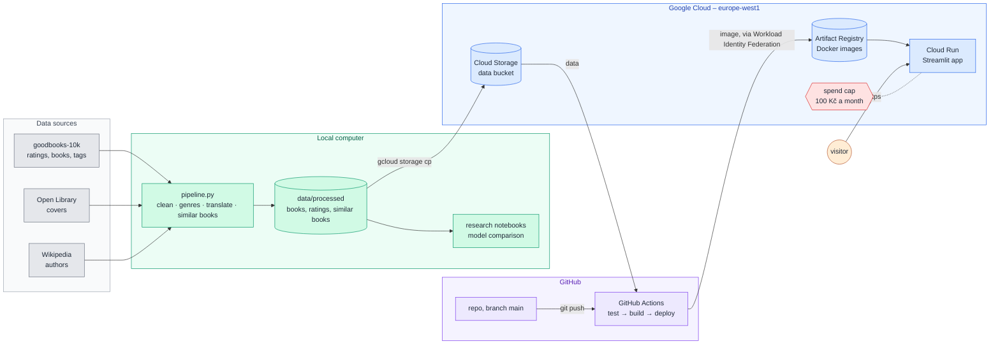
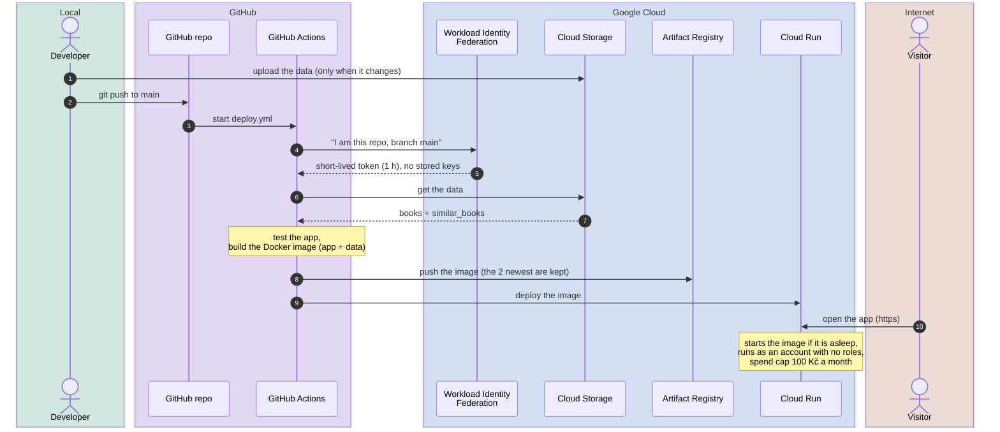

# Book Recommender

Pick a book or an author, get similar books – based on what 53k Goodreads readers liked.

**Live app:** https://book-recommender-bfwqj6zvfq-ew.a.run.app (first load after a pause takes a few seconds – the app scales to zero)

## 1. Architecture



The pipeline and the research run locally; only the app runs in the cloud. A push to `main` tests the app, packs it
with the data into a Docker image and deploys it to Cloud Run. Covers and author photos are loaded by the visitor's
browser straight from Open Library and Wikimedia.

## 2. Project structure

Folders by where the code runs – ☁️ cloud (Cloud Run), 💻 local, 🔧 build and deployment, 📄 docs and settings:

```
book_recommender/
│
├── app/                          ☁️  goes into the Docker image and runs on Cloud Run
│   ├── app.py                        Streamlit app – pick a book or an author, see similar books
│   ├── static/                       header photo, page shown after the idle timeout
│   └── test_app.py                   smoke test with the real data – run on GitHub before deploying, not in the image
│
├── pipeline/                     💻 makes the data the app reads
│   ├── pipeline.py                   raw data -> books, interactions, similar books
│   └── test_pipeline.py              tests of the pipeline
│
├── research/                     💻 experiments, not used by the app
│   ├── eda.ipynb                     data exploration
│   ├── experiments.ipynb             model comparison: split, features, models, training, evaluation, Excel report
│   └── output/                       results, splits, features, models – not in git
│
├── data/                         📦 raw/, cache/, processed/ – made by the pipeline, not in git;
│                                    the two app files in processed/ go via Cloud Storage into the image
│
├── requirements_docker.txt       ☁️  libraries of the app (in the image)
├── requirements_local.txt        💻 everything for local work – pipeline, research, tests (includes the above)
│
├── Dockerfile, .dockerignore     🔧 how the image is packed (what goes to the cloud)
├── .github/workflows/deploy.yml  🔧 how it is deployed (GitHub Actions)
├── .streamlit/config.toml        ☁️ 💻 Streamlit settings, used in the cloud and locally
│
└── README.md, pytest.ini, .gitignore   📄
```

Only `app/` (without the test), `.streamlit/`, the libraries from `requirements_docker.txt` and the two data files go
to the cloud – everything else stays local or on GitHub. `.dockerignore` enforces it: everything is excluded except
these files, so nothing else can slip into the image by mistake.

## 3. Data sources

| Source | What we take |
|---|---|
| [goodbooks-10k](https://github.com/zygmuntz/goodbooks-10k) | 6M ratings from 53k users on 10k books, book metadata, reader tags, Goodreads XML with descriptions – a public snapshot of Goodreads (its API closed in 2020) |
| [Open Library](https://openlibrary.org/developers/api) | book covers – larger and more complete than in goodbooks-10k |
| [Wikipedia](https://en.wikipedia.org/api/rest_v1/) | short author description, bio and photo (URL only) – text under CC BY-SA, the app links the source |
| [Unsplash](https://unsplash.com) | header photo by [Eldem Ozdemir](https://unsplash.com/@eldemozd) |

goodbooks-10k by [zygmuntz](https://github.com/zygmuntz) ([FastML](http://fastml.com/goodbooks-10k)) is licensed under [CC BY-SA 4.0](https://creativecommons.org/licenses/by-sa/4.0/).

## 4. Data preparation – `pipeline/pipeline.py`

The pipeline runs locally. Everything fetched from the internet (covers, author info, translations) is cached in
`data/cache/`, so the first run takes about 1.5 hours and later runs about a minute.

| Step | What happens | Result |
|---|---|---|
| **Download** | goodbooks-10k files into `data/raw/` | 6M ratings, 10k books |
| **Cleaning** | useful columns only, broken ISBNs fixed, language codes unified; `authors` split into the main `author` and `contributors` (illustrators, translators); invalid and duplicate ratings removed; checks that every rating has a book and every book has ratings | clean books and ratings |
| **Genres** | goodbooks-10k has no genres, only 34k free-form reader tags (mostly shelves like `to-read`); 30 genres picked by hand with their tag variants (`sci-fi`, `scifi` → science fiction), votes summed per book | 1–4 genres per book, e.g. *The Hobbit* → fantasy, classics |
| **Descriptions** | taken from the Goodreads XML; ~200 non-English ones (2 %) translated to English with a local Hugging Face model (NLLB) | English description for 9,685 books |
| **Author info** | Wikipedia summary and photo per author, kept only when the page is about a writer (not a namesake) | 2,876 of 3,888 authors, 2,208 with a photo |
| **Covers** | looked up on Open Library by ISBN, Goodreads cover as fallback | 9,108 + 746 covers, 146 books without one |
| **Titles** | 76 books with titles in Arabic, Japanese, Greek or Cyrillic script are marked – the app is English, so they are not shown | |
| **Similar books** | item-item similarity from all ratings ≥ 4 (two books are similar when the same readers liked them), computed once so the app only looks them up | 50 most similar books for every book |

| Output in `data/processed/` | Content | Used by |
|---|---|---|
| `books.parquet` | 10k books – title, author, genres, description, cover, author info | app, research |
| `interactions.parquet` | 6M ratings – who rated which book | similar books, research (not the app) |
| `similar_books.parquet` | 50 most similar books for every book | app |

## 5. Research – `research/experiments.ipynb`

Compares four ways to find similar books. Details are in the notebook; per-user results, the top 50 for sample users
and similar books for popular titles are in `research/output/results.xlsx`.

| Model | How it works |
|---|---|
| Popularity | counts how many readers liked each book and offers the most liked ones, whatever book you pick – the baseline every model has to beat |
| **Item-item** | compares books by their readers: the more readers two books share, the more similar they are – no training, see [section 6](#6-how-similar-books-are-found--item-item) |
| ALS | *matrix factorization* (`implicit`): squeezes the big user × book matrix into a short vector (32 numbers) for every user and every book, so that a user's vector fits the books they liked; it learns users and books in turns (*alternating least squares*). Similar books = books with the closest vectors |
| Two-tower | neural network (PyTorch) with two parts – one turns a user into a vector, the other a book; trained so that a user lands close to the books they liked and far from the other books in the same batch. Similar books = closest book vectors. v2 also feeds the book part with author, year, language, genres and a vector of the description (MiniLM) |

Ratings ≥ 4 count as "liked"; each user's liked books are split 80 / 10 / 10 into train / validation / test.
Models are tuned on validation, the test set is used once at the end. The metrics:

| Metric | What it measures |
|---|---|
| **Book hit rate@10** (main) | the app scenario – from one book the user liked, is at least one of its 10 most similar books among the user's hidden books? |
| Recall@10 | share of the user's hidden books that appear in the user's top 10 recommendations |
| NDCG@10 | like recall, but a hit at rank 1 counts more than a hit at rank 10 |
| Coverage@10 | share of the whole catalogue recommended to at least one user – low means always the same bestsellers |

| Model | Book hit rate@10 | Recall@10 | NDCG@10 | Coverage@10 |
|---|---|---|---|---|
| Popularity | 0.289 | 0.052 | 0.060 | 0.6 % |
| **Item-item** | **0.344** | 0.175 | 0.201 | 38 % |
| ALS | 0.285 | 0.137 | 0.140 | 31 % |
| Two-tower | 0.294 | 0.210 | 0.225 | 98 % |
| Two-tower + book features | 0.292 | **0.212** | **0.227** | **98 %** |

The two-tower model is best at recommending books to a user, but for book → similar books simple item-item is clearly
better. **The app uses item-item.**

## 6. How similar books are found – item-item

The method chosen by the research above.

Two books are similar when the **same readers liked both**. A rating of 4 or 5 counts as "liked"; every book is then
the set of readers who liked it, and the similarity of books *A* and *B* is the cosine similarity of those sets:

$$\text{similarity}(A, B) = \frac{\text{readers who liked both}}{\sqrt{\text{readers of } A \times \text{readers of } B}}$$

It is 1 when exactly the same people liked both books and 0 when nobody liked both. The pipeline computes it for all
10k × 10k pairs at once (sparse user × book matrix) and keeps the 50 most similar books for every book.

**Example – *The Hobbit*** (liked by 12,089 readers), real numbers from the data:

| Book | Liked by | Liked both | Similarity |
|---|---:|---:|---:|
| The Fellowship of the Ring | 10,269 | 6,970 | 6,970 / √(12,089 × 10,269) = **0.626** |
| Harry Potter and the Sorcerer's Stone | 18,308 | 6,774 | 6,774 / √(12,089 × 18,308) = **0.455** |
| The Two Towers | 5,486 | 3,320 | **0.408** |
| The Return of the King | 5,561 | 3,305 | **0.403** |
| The Lion, the Witch and the Wardrobe | 9,862 | 4,243 | **0.389** |
| *for comparison:* Twilight | 7,683 | 1,750 | 0.182 – not in the top 50 |

*Harry Potter* shares almost as many readers with *The Hobbit* as *The Fellowship of the Ring*, but it is liked by many
more people overall. The square root in the denominator corrects for that – otherwise the most popular books would be
"similar" to everything.

**For an author**, the similarities to all of the author's books are added up and the author's own books are left out:

$$\text{score}(B) = \sum_{A \,\in\, \text{author's books}} \text{similarity}(A, B)$$

## 7. Deployment – Google Cloud

The app runs on **Cloud Run** in project `book-recommender-512711`, region `europe-west1` (Belgium).
Every push to `main` that changes the app deploys it automatically with **GitHub Actions**.



**What was set up** (once, with `gcloud` and in the console):

| Part | Think of it as | What it does |
|---|---|---|
| **Docker image** | a packed box | the app, Python, libraries and data in one package – runs the same everywhere |
| **GitHub Actions** | a worker on GitHub | after a push runs `deploy.yml`: tests the app, packs the box, sends it to the cloud |
| **Workload Identity Federation** | the gatekeeper | lets the worker in only when it comes from this repository and `main` – no keys stored in GitHub |
| **`github-deployer`** (service account) | the worker's badge | may push the image, read the data and deploy the app – nothing else |
| **Cloud Storage** (bucket) | the data store | private bucket with the two data files; packed into the box at build time |
| **Artifact Registry** | the box store | built images; the 2 newest are kept, older ones are deleted automatically |
| **Cloud Run** | the counter | starts the box when a visitor comes, puts it to sleep when nobody does |
| **`book-recommender-run`** (service account) | the app's identity | the account the app runs as – no roles at all, the app needs no GCP access |
| **Spend cap** | the fuse | pauses Cloud Run at 100 Kč a month |

Service accounts are accounts for programs, not people – no password, only the roles above.

### 7.1 Cost safety

Streamlit keeps a connection open while the page is open, and Cloud Run bills that time. So:

| Limit | Protects against |
|---|---|
| max 1 instance (up to 80 visitors at once) | traffic spikes and bots – costs can never grow fast |
| idle check in the page: "Still there?" with a countdown after 30 s, the session ends after 2 min | forgotten open tabs |
| 5 min timeout per connection | endless connections |
| spend cap 100 Kč (≈ 4 USD) a month, e-mails at 50 / 80 / 100 % | slow leaks – Google pauses the app until the next month |

Normal portfolio traffic fits the Cloud Run free tier; the worst case is about 5 USD a month.
